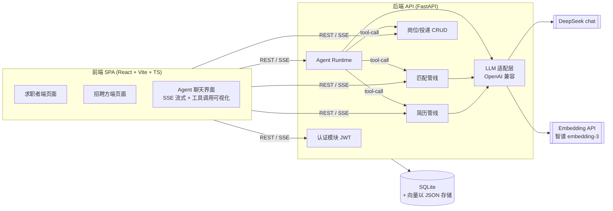
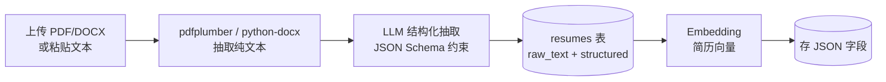
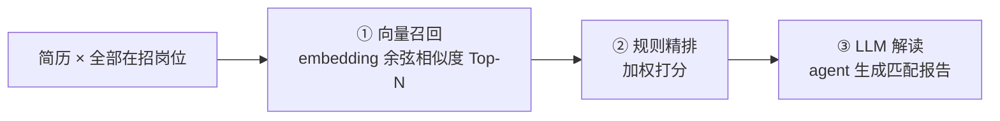
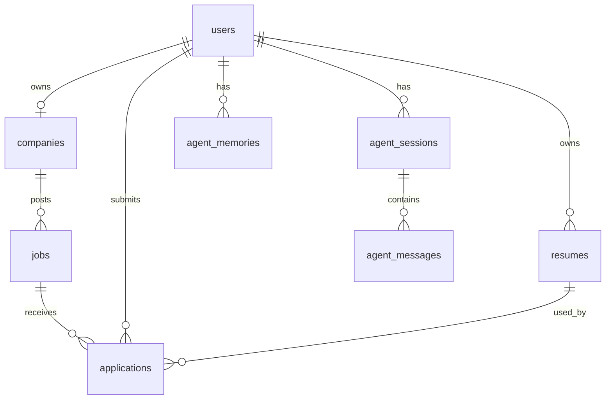

# JobCopilot 开发文档

> 招聘求职双边平台 × 双 Agent 助手 · 前后端分离架构
> 版本：v0.1（决策定稿） · 日期：2026-11-20

---

## 1. 项目定位

- **性质**：纯学习项目，不做真实上线，不以市场指标为验收标准。
- **验收标准**：技术学习价值 + 可演示性。每条主线功能必须能在一个端到端演示脚本中跑通（见 §12）。
- **学习目标**（按含金量排序）：
  1. 自研 Agent Runtime（tool-calling 执行循环、工具注册、会话记忆）
  2. LLM 结构化抽取管线（PDF 简历 → 结构化 JSON）
  3. 三段式匹配管线（向量召回 → 规则精排 → LLM 解读）
  4. 跨会话长期记忆（agent 自主读写记忆库）
  5. 前后端分离 + SSE 流式输出 + JWT 认证工程实践

**明确砍掉**（复杂度预算不花在这里）：支付、合规审核、实名认证、真实规模数据处理、复杂权限系统、消息通知基础设施。

---

## 2. 决策记录

以下决策经两轮评审敲定，后续开发不得静默更改；如需推翻，先更新本文档。

| # | 决策项 | 结论 |
|---|--------|------|
| D1 | 项目性质 | 学习项目，验收 = 学习价值 + 可演示性 |
| D2 | 平台形态 | 双端（求职者 C 端 + 招聘方 B 端），每端功能极简 |
| D3 | Agent 范围 | 双侧各一个 agent；匹配先做「系统计算 + agent 解读」，双 agent 自主对谈作为二期彩蛋已实现（见 §7.5） |
| D4 | Agent 深度 | 自研 tool-calling Agent Runtime（不用 LangChain/LangGraph），向 multi-agent 伸手但不做 |
| D5 | 数据来源 | 手造/AI 生成种子数据（约 50 岗位 + 30 简历），预埋难匹配 case；不爬虫 |
| D6 | 前后端 | **前后端分离**。前端 React + Vite + TypeScript；后端 Python FastAPI |
| D7 | LLM | DeepSeek `deepseek-chat`（function calling），走 OpenAI 兼容适配层，模型可配置切换。Key 已验证可用（复用 stellar-mall，见下） |
| D8 | Embedding | **阿里云百炼 `text-embedding-v4`，维度 1024**。经 stellar-mall 的百炼专属端点（OpenAI 兼容模式）实测可用且支持自定义维度；Key 已验证。见下「模型服务配置」 |
| D9 | 简历输入 | 上传 PDF/DOCX 解析为主，纯文本粘贴兜底 |
| D10 | 账号体系 | **完整注册/登录（JWT）**，角色：`seeker` / `employer`，预置演示账号 |
| D11 | Agent 记忆 | 会话内上下文 + 极简长期记忆（`save_memory` / `search_memory` 两个工具，agent 自主管理） |
| D12 | 匹配呈现 | 分数 + agent 生成的解读（匹配理由 / 差距 / 补齐建议） |

---

## 3. 系统架构



要点：

- **单体后端、模块化分层**：一个 FastAPI 应用按模块切分（routers / services / agent / llm），不做微服务。
- **Agent 的工具就是后端 service 函数**：agent 通过 tool-calling 复用与 REST API 相同的业务层，保证行为一致、代码不重复。
- **LLM 适配层**：所有对 LLM / Embedding 的调用统一走 `llm/` 适配器（OpenAI 兼容协议），chat 与 embedding 可分别配置 provider、model、api_key、base_url，环境变量驱动，可随时切换供应商。

---

## 4. 技术栈

| 层 | 选型 | 备注 |
|----|------|------|
| 前端 | React 18 + Vite + TypeScript | UI 资产复用方案见 §15 |
| 前端 UI | Tailwind CSS + shadcn/ui | |
| 前端数据层 | TanStack Query | |
| 流式输出 | SSE（`fetch` + ReadableStream 解析） | 不引 WebSocket，SSE 足够 |
| 后端 | Python 3.12 + FastAPI + Pydantic v2 | |
| ORM | SQLAlchemy 2.0 + SQLite | 数据量小；向量存 JSON 字段，检索用 numpy 暴力余弦，文档注明生产可迁 PGVector |
| 认证 | JWT（python-jose / pyjwt）+ bcrypt | |
| 文档解析 | pdfplumber（PDF）、python-docx（DOCX） | |
| LLM | DeepSeek `deepseek-chat` | function calling，key 已实测可用 |
| Embedding | 阿里百炼 `text-embedding-v4`（1024 维） | OpenAI 兼容专属端点，key 已实测可用 |
| 部署/演示 | 前端 `vite build` 静态文件 + 后端 uvicorn 本地跑通即可 | 不上云 |

仓库结构（monorepo）：

```
JobCopilot/
├── docs/                  # 本文档
├── backend/
│   ├── app/
│   │   ├── main.py
│   │   ├── config.py      # 环境变量 / LLM provider 配置
│   │   ├── db.py
│   │   ├── models/        # SQLAlchemy models
│   │   ├── schemas/       # Pydantic schemas
│   │   ├── routers/       # auth / resumes / jobs / applications / match / agent
│   │   ├── services/      # 业务逻辑（agent tools 复用这一层）
│   │   ├── agent/         # Agent Runtime
│   │   │   ├── runtime.py     # 执行循环
│   │   │   ├── tools.py       # 工具注册器 + 两个 agent 的工具清单
│   │   │   ├── prompts.py     # 系统 prompt
│   │   │   └── memory.py      # 会话记忆 + 长期记忆
│   │   ├── llm/           # OpenAI 兼容适配层（chat + embedding）
│   │   ├── matching/      # 三段式匹配管线
│   │   └── seed/          # 种子数据脚本
│   └── tests/
├── frontend/
│   └── src/
│       ├── pages/         # 见 §10
│       ├── components/
│       ├── api/           # REST + SSE client
│       └── stores/
└── seed_data/             # 岗位/简历原始数据（markdown/json）
```

---

## 5. 账号与认证

- 注册字段：用户名、密码、角色（`seeker` / `employer`）、显示名。邮箱选填，不做验证邮件。
- 登录签发 JWT（payload 含 `user_id`、`role`），前端存内存 + localStorage，请求带 `Authorization: Bearer`。
- 角色决定可见路由与 API 权限：employer 角色创建/绑定一家公司（company）。
- 预置演示账号（种子脚本创建）：
  - `zhangsan / demo1234`（求职者，已挂一份简历）
  - `hr-li / demo1234`（招聘方，预置公司 + 在招岗位）

---

## 6. 简历管线（C 端核心）



- 结构化 Schema（LLM 以 JSON mode / tool 强约束输出）：

```json
{
  "name": "张三",
  "title": "后端开发工程师",
  "skills": ["Python", "FastAPI", "PostgreSQL"],
  "years_of_experience": 3,
  "education": [{"school": "...", "degree": "本科", "major": "...", "period": "..."}],
  "work_experience": [{"company": "...", "role": "...", "period": "...", "highlights": ["..."]}],
  "expectations": {"locations": ["上海"], "salary_min": 20, "salary_max": 35, "job_types": ["全职"]}
}
```

- 抽取失败（解析乱码 / 非 resume 内容）→ 报错并引导用户改用文本粘贴（D9 的兜底）。
- 简历可重新上传/编辑重新抽取，向量同步更新。

---

## 7. Agent 设计

### 7.1 Agent Runtime（自研，核心学习点）

一个通用执行循环，两个 agent 共用，仅系统 prompt 与工具集不同：

```
loop:
  1. 组装 messages（system prompt + 会话历史 + 用户输入）
  2. 调 LLM（带 tools 定义，OpenAI function calling 协议）
  3. 若返回 tool_calls：
       a. 逐个执行工具（工具 = 注册的 service 函数，参数经 Pydantic 校验）
       b. 把 tool 结果以 tool role 追加进 messages
       c. 回到 1（LLM 基于结果继续推理或再调工具）
  4. 若返回纯文本 → 该轮结束，流式推给前端
  5. 全程消息落库（agent_messages 表），SSE 事件含：token 增量、tool_call 开始/结束、tool 结果摘要
```

约束与保护：
- 单轮对话工具调用次数上限（如 8 次），防死循环。
- 工具执行异常不炸循环：异常信息作为 tool result 回喂 LLM，让它自行处理。
- 所有工具自动注入当前 user_id，agent **永远只能操作本人资源**（权限在工具层收口，不依赖 prompt）。

### 7.2 求职者 Agent（「求职助手」）

| 工具 | 说明 |
|------|------|
| `get_my_resume()` | 读取本人结构化简历 |
| `search_jobs(keywords?, location?, salary_min?)` | 检索在招岗位 |
| `get_job_detail(job_id)` | 岗位详情 |
| `match_jobs_for_me(top_n?)` | 对本人简历跑匹配管线，返回岗位 + 分数 + 解读 |
| `suggest_resume_improvements(job_id?)` | 针对目标岗位给简历优化建议（只给建议，不代改） |
| `apply_to_job(job_id, cover_letter?)` | 投递，可由 agent 起草求职信 |
| `get_my_applications()` | 投递状态列表 |
| `start_mock_interview(job_id?)` | 基于目标岗位的多轮模拟面试（会话内进行） |
| `save_memory(content)` / `search_memory(query)` | 长期记忆读写 |

系统 prompt 要点：求职顾问人设；先了解用户再推荐；推荐岗位必须引用真实匹配结果，禁止编造；投递前向用户确认。

### 7.3 招聘方 Agent（「招聘助手」）

| 工具 | 说明 |
|------|------|
| `generate_job_description(要求描述)` | 生成结构化 JD 草稿 |
| `create_job(...)` / `update_job(...)` | 发布/更新岗位（发布前需用户确认） |
| `list_my_jobs()` | 本公司在招岗位 |
| `list_candidates(job_id)` | 该岗位投递列表（含匹配分） |
| `screen_candidate(application_id)` | 单份简历 vs 岗位的深度评估 |
| `rank_candidates(job_id)` | 候选人排序 + 理由 |
| `update_application_status(application_id, status, note?)` | 推进流程（submitted → screening → interview → offer / rejected） |
| `save_memory(content)` / `search_memory(query)` | 长期记忆读写 |

### 7.4 记忆设计（D11）

- **会话记忆**：`agent_sessions` + `agent_messages` 落库，上下文窗口取最近 N 条（超出做简单截断，不做摘要压缩——记录为已知取舍）。
- **长期记忆**：`agent_memories` 表（user_id, content, embedding, created_at）。agent 通过 `save_memory` 写入对用户的认知（偏好城市、期望薪资、性格特点），`search_memory` 语义检索。系统 prompt 指示：会话开始时主动检索一次用户记忆，获得新认知时主动保存。
- 演示验收：新开一个会话，agent 能记得上个会话里用户说过的偏好。

### 7.5 彩蛋：双 Agent 自主对谈

- 入口：招聘方「候选人看板」→ 候选人详情 →「AI 双方面谈」。
- 编排：`app/agent/duel.py`，求职者 Agent 与招聘方 Agent 交替发言（默认 2 轮 / 4 次），各自持有受限只读工具集，事件经 SSE 实时推送。
- 约束：仅岗位所属招聘方可发起；对谈不落库、不产生投递或状态变更等副作用；双方 prompt 显式注入岗位 id 与投递 id，避免工具参数臆测。

---

## 8. 匹配管线（三段式）



1. **向量召回**：简历（技能 + 经历摘要拼接）与 JD（标题 + 描述 + 技能拼接）各自 embedding，余弦相似度取 Top-N（N=20）。SQLite 存向量 JSON，numpy 暴力计算。
2. **规则精排**（总分 100）：
   - 必需技能命中率 40 分（命中数 / 必需技能数）
   - 加分技能命中率 10 分
   - 年限匹配 20 分（达标满分，差 1 年扣 10，差 2+ 年扣 20）
   - 地点匹配 15 分（完全重叠 15 / 同城 10 / 不限 8 / 冲突 0）
   - 薪资区间重叠 15 分（重叠比例 × 15）
3. **LLM 解读**：输入双方结构化 JSON + 规则分明细，输出：匹配理由 / 主要差距 / 补齐建议 / 一句话结论。解读结果缓存到 `applications.match_explanation`，避免重复调用。

---

## 9. 数据模型



| 表 | 关键字段 |
|----|----------|
| `users` | id, username(unique), password_hash, role(seeker/employer), display_name, created_at |
| `companies` | id, owner_user_id, name, industry, description |
| `jobs` | id, company_id, title, description, required_skills(JSON), preferred_skills(JSON), experience_min/max, location, salary_min/max(万/月), status(open/closed), embedding(JSON，实现时补充), created_at |
| `resumes` | id, user_id, raw_text, structured(JSON), embedding(JSON), source(upload/paste), updated_at |
| `applications` | id, job_id, resume_id, user_id, status, match_score(float), match_explanation(text), cover_letter, status_note(实现时补充), created_at, updated_at |
| `agent_sessions` | id, user_id, agent_type(seeker/employer), title, created_at |
| `agent_messages` | id, session_id, role(user/assistant/tool/system), content, tool_calls(JSON), tool_call_id, created_at |
| `agent_memories` | id, user_id, content, embedding(JSON), created_at |

---

## 10. API 设计（摘要）

REST 前缀 `/api`，响应统一 `{code, data, message}`。

| 模块 | 端点 | 说明 |
|------|------|------|
| auth | `POST /auth/register` `POST /auth/login` `GET /auth/me` | JWT |
| resumes | `POST /resumes/upload`（multipart）`POST /resumes/paste` `GET /resumes/mine` `PUT /resumes/mine` | 上传解析 / 粘贴 / 查看 / 重解析 |
| jobs | `GET /jobs`（搜索过滤）`GET /jobs/{id}` `POST /jobs` `PUT /jobs/{id}` `GET /jobs/mine` | 招聘方 CRUD |
| applications | `POST /applications` `GET /applications/mine`（C 端）`GET /applications/job/{id}`（B 端）`PATCH /applications/{id}/status` | 投递链路 |
| match | `GET /match/jobs-for-me?top_n=` `GET /match/job/{id}/candidates` | 匹配管线 |
| interviews | `POST /interviews` `GET /interviews/mine` `GET /interviews/{id}` `POST /interviews/{id}/answers` `POST /interviews/{id}/complete` `GET /interviews/application/{application_id}` | 结构化模拟面试（二期 M5） |
| subscriptions | `GET /subscriptions` `POST /subscriptions` `PUT /subscriptions/{id}` `DELETE /subscriptions/{id}` `POST /subscriptions/scan` | 岗位订阅与增量扫描（二期 M6） |
| notifications | `GET /notifications` `POST /notifications/{id}/read` `POST /notifications/read-all` | 站内通知（二期 M6） |
| resumes（二期） | `GET /resumes/versions` `POST /resumes/versions/{id}/restore` `POST /resumes/optimize` `POST /resumes/optimize/apply` | 版本历史与按岗优化（M7） |
| feedback | `GET /jobs/{id}/feedback` `POST /jobs/{id}/feedback` | 收藏 / 不感兴趣（M7） |
| agent | `POST /agent/sessions` `GET /agent/sessions` `GET /agent/sessions/{id}/messages` `POST /agent/sessions/{id}/chat`（**SSE**）`POST /agent/duel`（彩蛋·双 Agent 对谈 SSE） | SSE 事件：`token` / `tool_start` / `tool_end` / `done` / `error` |

前端页面：

- **公共**：登录 / 注册
- **求职者**：简历管理（上传 + 结构化卡片展示）、岗位浏览/搜索/详情、我的投递（状态时间线）、Agent 聊天（全屏或侧栏，工具调用过程折叠可视化）
- **招聘方**：岗位管理（列表 + JD 编辑器）、候选人看板（按状态分列）、Agent 聊天
- **匹配详情**：分数环形图 + 规则分明细 + agent 解读

---

## 11. 种子数据方案（D5）

- `seed_data/jobs/`：约 50 个岗位，markdown 编写，覆盖 5–6 个方向（后端/前端/算法/产品/运营/测试），技能、年限、薪资、城市分布故意拉开梯度。
- `seed_data/resumes/`：约 30 份简历，含：
  - 完美匹配型、部分匹配型（缺 1–2 个必需技能）、年限不足型、地域冲突型、薪资错位型 —— 每种至少 3 份，用于演示匹配管线的区分度。
- 种子脚本：解析上述文件 → 建表写入 → 调 embedding 生成向量 → 创建两个演示账号及一家演示公司。
- 可重复执行（幂等：先清空再灌入）。

---

## 12. 里程碑

| 里程碑 | 内容 | 完成标志 |
|--------|------|----------|
| **M0 骨架** | monorepo 初始化、FastAPI + Vite 跑通、JWT 注册/登录/角色路由守卫、SQLite 建表 | 两个演示账号能在前端登录进各自首页 |
| **M1 数据与 CRUD** | 种子数据、岗位/投递/简历的全套 REST API + 前端页面 | HR 手动发一个岗位，求职者手动浏览并投递 |
| **M2 管线** | 简历上传解析 + LLM 结构化抽取；embedding；三段式匹配 + 匹配详情页 | 上传 PDF 简历出结构化卡片；岗位列表按匹配分排序且有解读 |
| **M3 Agent** | Agent Runtime + 双 agent 工具集 + SSE 聊天界面（含工具调用可视化） | 求职者通过对话完成「找岗位→看匹配→投递」；HR 通过对话完成「发岗位→筛人→推进状态」 |
| **M4 记忆与打磨** | 长期记忆读写、演示脚本全流程走通、种子数据调优、演示录屏 | §13 演示脚本无报错一次通过 |

开发顺序即 M0→M4，每个里程碑有独立可演示产出。二期里程碑（M5–M8：面试、订阅提醒、简历版本与反馈）见 §18.6。

---

## 13. 端到端演示脚本（最终验收）

1. **HR 发岗位**：`hr-li` 登录 → 对话「帮我招一个 3 年经验的 Python 后端，预算 25-35K，上海」→ agent 生成 JD → 用户确认 → 发布。
2. **求职者建简历**：`zhangsan` 登录 → 上传一份 PDF 简历 → 展示 LLM 抽取的结构化卡片。
3. **求职者找活**：对话「帮我找适合我的岗位」→ agent 调 `match_jobs_for_me` → 展示 Top 岗位 + 匹配分 + 解读 → 「第一个岗位我技能差在哪？」→ agent 指出缺 FastAPI 经验并给补齐建议 → 「帮我投第一个」→ agent 起草求职信 → 确认投递。
4. **HR 筛人**：`hr-li` 对话「看看刚发的岗位有哪些候选人」→ 排序列表 + 匹配分 → 「详细评一下第一名」→ 深度评估 → 「约面试」→ 状态推进为 interview。
5. **记忆彩蛋**：`zhangsan` 新开一个会话 → 「还记得我想去哪个城市吗？」→ agent 从长期记忆中答出（上个会话提过）。

---

## 14. 模型服务配置

API key 复用 stellar-mall 项目（源：`D:\AIProjects\stellar-mall\rag-backend\.env`），**密钥不写入本文档与仓库**，M0 时放入 `backend/.env`（gitignore 掉）。

| 项 | 值 | 验证状态 |
|----|----|----------|
| Chat: DeepSeek | base_url `https://api.deepseek.com/v1`，model `deepseek-chat` | ✅ 实测通 |
| Embedding: 阿里百炼专属端点 | base_url `https://ws-qhkijshmatylj7e6.cn-beijing.maas.aliyuncs.com/compatible-mode/v1`（OpenAI 兼容模式），model `text-embedding-v4`，dimensions 1024 | ✅ 实测通，v2/v4 均可用，v4 支持自定义维度 |
| 备选 embedding | 同端点的 `text-embedding-v2`（1536 维）、`BAAI/bge-large-zh-v1.5`（1024 维，stellar-mall 在用） | 切换仅改环境变量 |

注意：该端点为百炼专属（workspace key `sk-ws-` 前缀），非公共 dashscope 端点；切换供应商 = 切向量维度，需重跑种子脚本 embedding 环节（已设计为幂等）。

---

## 15. 前端 UI 资产（ui-atlas 复用）

现成资产库：`D:\AIProjects\ui-atlas`（纯静态单文件图鉴，60 风格样例 + 100 动效 + 动效 token 系统）。约定：**CSS token 与样式直接拷贝复用；动效 JS 逻辑用 React 重写，不引原脚本**（原文件是零依赖原生 JS，仅为参考实现）。

### 15.1 视觉基线（styles.json token → Tailwind/shadcn 配置）

| 端 | 基线样例 | 理由 |
|----|----------|------|
| B 端（HR 工作台） | `swiss-admin`（瑞士国际主义·后台） | 干净专业，看板/表格形态成熟 |
| 数据展示（匹配分、统计卡） | `dashboard`（数据看板） | 直接对位匹配详情页 |
| C 端（求职者） | `techblue` 或 `scandi` | 亲和、轻量 |

styles.json 每条含完整 color/radius/shadow/font tokens；ui-atlas 的 app.js 支持一键导出 Tailwind / shadcn 配置，M0 建设计系统时直接取用。

### 15.2 动效 token

`motion/tokens.css`（17 个：`--dur-*` / `--ease-*` / `--move-*` / `--stagger-*`，含 reduced-motion 兜底）整体引入 Tailwind 入口 CSS，全站动效统一走这套 token。

### 15.3 页面 × 动效映射（effects/<id>.html）

| JobCopilot 场景 | 复用效果 | 说明 |
|-----------------|----------|------|
| Agent 聊天流式输出 | `typewriter` | 打字机逐 token 渲染 |
| 工具调用过程折叠面板 | `accordion` / `table-row-expand` | tool_start/tool_end 展开-收起 |
| Agent「思考中」状态 | `conic-border` | 流光边框圈住消息卡片 |
| 匹配分数 | `counter` / `odometer` | 数字滚动到最终分 |
| 岗位/候选人列表入场 | `stagger-in` | 配合 tokens 的 --stagger-* |
| 投递状态时间线 | `stepper` | submitted → interview → offer |
| 候选人看板拖拽换列 | `drag-sort` | B 端看板核心交互 |
| 匹配管线计算中 | `skeleton` | 组件工坊版可直接复制 |
| 登录/注册表单报错 | `shake` | |
| 投递成功 | `check-draw` / `confetti` | 二选一，避免过度 |
| 全局通知 | `toast` | 组件工坊版，键盘可达 |

### 15.4 组件工坊

`motion/components.html` 的 8 个零依赖组件（入场 / 错峰 / 磁吸 / 提示 / 通知 / 骨架屏 / 手风琴 / 复制反馈）已抽象为「显式参数、可销毁、键盘可达、减动效给终态」，迁移到 React 时遵循同一约定。

---

## 16. 风险与待定项

| # | 事项 | 状态 |
|---|------|------|
| R1 | **Embedding 供应商**：已定稿 —— 阿里百炼 `text-embedding-v4` @ 1024 维，key 实测可用（见 §14） | ✅ 已解决 |
| R2 | DeepSeek function calling 偶发 JSON 格式抖动：runtime 需做重试（1 次）+ 报错回喂 | 设计时已纳入 |
| R3 | PDF 解析质量（双栏/表格简历可能乱）：降级路径为文本粘贴（D9） | 已有兜底 |
| R4 | 上下文超长：目前策略为简单截断最近 N 条，不压缩摘要 | 已知取舍，二期可加摘要 |
| R5 | SQLite 并发写入：学习项目单机演示，够用 | 接受 |

实现备注（与初稿的差异，均为实现期确定）：

- **建表方式**：使用 SQLAlchemy `Base.metadata.create_all`（启动与种子脚本均幂等），未引入 Alembic 迁移链——模型仍在快速演进，迁移链对本项目无学习增益。
- **前端端口**：开发端口使用 `5180`（`vite.config.ts` 中 `strictPort`），避免与本机其他 5173 项目冲突；后端 CORS 已同时放行 5173 / 5180。
- **`jobs.embedding`**：初稿漏写，匹配管线需要岗位向量，已在 jobs 表补充 JSON 字段；岗位文案变更时置空、下次匹配自动重算。
- **`applications.status_note`**：`update_application_status(note)` 需要落库位置，已补充该字段。
- **记忆注入**：新会话首轮由 runtime 自动检索一次长期记忆并注入 system prompt（工具 `search_memory` 仍对 agent 开放），保证 §13-5 的记忆彩蛋稳定可演示。
- **状态流转约束**：`applications` 状态只能向前推进或淘汰（submitted → screening → interview → offer / rejected），`offer` / `rejected` 为终态；只有岗位所属公司的招聘方可以改状态，求职者不可自行推进。
- **防重复投递**：`applications` 增加 `(user_id, job_id)` 唯一约束，并发/工具重试由数据库兜底。
- **种子数据**：演示账号 `zhangsan` 预置零投递，保证 §13-3「找岗位 → 投递」链路可从零演示；其余 29 位候选人预置 87 条投递供招聘端演示。
- **自动化测试**：`backend/tests` 共 29 项（匹配规则 5 + API 集成 7 + Agent Runtime 3 + 双 Agent 对谈 3 + 面试 2 + 订阅 2 + 简历版本与反馈 3 + Agent 工具 4）。Runtime 测试用 mock 的流式 LLM，覆盖工具循环事件顺序、工具异常回喂、新会话记忆注入，不触网、不花钱。

---

## 17. 运行指南（本地）

前置：Python 3.12、Node 18+。首次运行按下面命令装好依赖并灌种子数据；之后可用一键脚本启动。

```bash
# 一键启动（Windows，推荐）：双击根目录 start.bat
# 等价命令：scripts/dev.ps1（PowerShell）
powershell -ExecutionPolicy Bypass -File scripts/dev.ps1
```

```bash
# 1) 后端
cd backend
python -m venv .venv                      # 已有 .venv 可跳过
.venv/Scripts/python -m pip install -r requirements.txt
# 确认 backend/.env 已填入 CHAT_API_KEY / EMBEDDING_API_KEY（见 §14）
.venv/Scripts/python -m app.seed.generate_seed_data   # 生成 50 岗位 + 30 简历 markdown
.venv/Scripts/python -m app.seed.seed                 # 建表 + 灌库 + 生成向量（幂等）
.venv/Scripts/python -m uvicorn app.main:app --port 8000

# 2) 前端（另开终端）
cd frontend
npm install
npm run dev                                # http://127.0.0.1:5180
```

接口文档：`http://127.0.0.1:8000/docs`。单元测试：`cd backend && .venv/Scripts/python -m pytest -q`。

演示账号：`zhangsan / demo1234`（求职者）、`hr-li / demo1234`（招聘方，星澜科技）；其余 `cand02~cand30`、`hr-01~hr-09` 密码同为 `demo1234`。

---

## 18. 二期规划（M5–M8）

> 状态：二期 M5–M8 已全部完成（后端 29 项测试通过）。原则：复用现有 Agent Runtime / 匹配管线 / SSE / 统一响应体，不引入新基础设施（不做真实推送、不做 IM）。

### 18.1 范围

| 编号 | 功能 | 核心价值 |
|---|---|---|
| P1 | 结构化模拟面试 + 面试报告 | 岗位定制出题、逐题评分、可解释报告；HR 可查看候选人报告 |
| P2 | 岗位订阅 + 站内提醒 | 保存筛选条件、扫描新增岗位、按匹配分生成站内通知 |
| P3 | 简历版本与按岗优化 | 版本快照/回滚、针对目标岗位的改写建议与 diff |
| P4 | 推荐反馈闭环 | 「不感兴趣 / 收藏」参与排序偏置，原规则分保持可解释 |

不做：邮件/短信推送、站内 IM、支付、合规审核。

### 18.2 数据模型（新增）

| 表 | 关键字段 |
|----|----------|
| `interviews` | id, user_id(候选人), job_id, application_id(可空), status(draft/in_progress/completed), plan(JSON), answers(JSON), report(JSON), created_at, updated_at |
| `subscriptions` | id, user_id, name, filters(JSON: keywords/location/salary_min/skills/match_score_min), active, last_checked_at, created_at |
| `notifications` | id, user_id, type(job_recommendation/interview_report), title, payload(JSON), dedupe_key, read_at, created_at；唯一约束 `(user_id, type, dedupe_key)` |
| `resume_versions` | id, resume_id, structured(JSON), label, note, created_at |
| `job_feedback` | id, user_id, job_id, action(dislike/save), reason, created_at；唯一约束 `(user_id, job_id)` |

### 18.3 API 设计

| 模块 | 端点 |
|------|------|
| interviews | `POST /interviews`（传 job_id，生成计划）`GET /interviews/{id}` `GET /interviews/mine` `POST /interviews/{id}/answers` `POST /interviews/{id}/complete`（生成报告）`GET /interviews/application/{application_id}`（HR） |
| subscriptions | `GET /subscriptions` `POST /subscriptions` `PUT /subscriptions/{id}` `DELETE /subscriptions/{id}` `POST /subscriptions/scan`（手动/登录触发，10 分钟节流） |
| notifications | `GET /notifications?unread=` `POST /notifications/{id}/read` `POST /notifications/read-all` |
| resumes | `GET /resumes/versions` `POST /resumes/versions/{id}/restore` `POST /resumes/optimize`（传 job_id）`POST /resumes/optimize/apply` |
| feedback | `POST /jobs/{id}/feedback`（dislike / save） |

### 18.4 Agent 工具扩展

- 求职者：`create_mock_interview(job_id)`、`submit_interview_answer(interview_id, answer)`、`get_interview_report(interview_id)`、`create_subscription(filters)`、`list_unread_notifications()`
- 招聘方：`get_candidate_interview_report(application_id)`
- 权限仍在工具层收口：HR 只能读取本公司投递产生的报告；订阅与通知只操作本人数据。
- 约定：`submit_interview_answer` 自动取下一道未答题；`get_interview_report` 在全部答完后自动触发评分与报告生成。

### 18.5 关键管线

**面试**
1. 出题：岗位 + 简历 → JSON（技术 / 项目 / 行为各 2 题，含考察点与参考答案要点）
2. 作答：逐题提交自由文本，`answers` 追加
3. 评分：按 rubric 逐题 0-100 + 依据（temperature 0.2），汇总为报告
4. 报告结构：`overall_score + dimensions{技能/项目/表达/动机} + strengths + risks + suggestions`，缓存进 `interviews.report`

**订阅扫描**
- 触发：登录后前端调用 `POST /subscriptions/scan`（同一用户 10 分钟内幂等，进程内节流）
- 增量：只处理 `created_at > last_checked_at` 的在招岗位；阈值过滤后写入 `notifications`，`dedupe_key=job_id` 保证同一岗位只提醒一次
- 水位回退 5 秒作为下一次扫描的起点，避免 SQLite 秒级精度漏掉同秒发布的岗位

**反馈闭环**
- `dislike` / `save` 记录到 `job_feedback`，仅在展示排序上加偏置（dislike −15、同公司/同方向 save +10），**不修改原始规则分**，保证匹配分仍可解释
- 排序使用独立的 `rank_score`（可超过 100，仅用于排序），`match_score` 保持原始值用于展示

**简历优化**
- `POST /resumes/optimize` 输出：缺失技能、表达改写建议、关键词补全（不直接改库）
- `apply` 时写入新 `resume_versions` 并重算向量，旧版本可回滚

### 18.6 里程碑

| 里程碑 | 内容 | 完成标志 |
|--------|------|----------|
| **M5 面试** | interviews 表 + 出题/评分管线 + 求职者面试训练页 + HR 报告页签 | 完成一次 6 题面试并生成报告，HR 可查看 |
| **M6 订阅提醒** | 订阅 CRUD + 增量扫描 + 通知铃铛 | 新岗位发布后，订阅者收到站内提醒且不重复 |
| **M7 简历与反馈** | 版本快照/回滚、按岗优化、反馈偏置 | 优化建议可应用并回滚；不感兴趣影响排序 |
| **M8 收口** | Agent 工具接入、演示脚本扩展、测试与文档 | 二期主链路可对话完成，测试全绿 |

M5–M8 均已实现并通过验收（测试见 §16，演示见 §18.8）。

### 18.8 二期演示脚本（补充）

1. **结构化面试**：`zhangsan` →「面试训练」→ 选择「Python 数据平台后端」→ 生成 6 题 → 逐题作答 → 生成报告（总分 / 四维度 / 逐题复盘）。
2. **HR 查看报告**：`hr-li` → 候选人看板 → 候选人详情 →「面试报告」。
3. **对话建面试**：求职助手说「针对岗位 53 生成结构化模拟面试」→ Agent 出题并逐题提问 → 全部答完后生成报告。
4. **岗位订阅**：求职助手说「订阅上海的 Python 岗位，25K 以上」→ 订阅创建；HR 发布新岗位 → 登录后自动扫描 → 铃铛出现推荐（同一岗位只提醒一次）。
5. **简历优化与回滚**：简历页 → 按岗位优化 → 生成建议 → 应用技能（生成新版本）→ 版本历史回滚。
6. **反馈闭环**：找岗位 → 对某岗位点「不感兴趣」→ 排序下降；点「收藏」→ 回到前列；再次点击清除反馈。

### 18.7 风险

| # | 事项 | 应对 |
|---|------|------|
| P-R1 | LLM 评分主观、波动 | rubric + 低温度 + 固定维度；定位为练习反馈，不承诺绝对准确 |
| P-R2 | 订阅扫描的 LLM 成本 | 先规则/向量筛选，LLM 只用于解读；增量 + 节流 |
| P-R3 | 通知噪音 | 匹配分阈值 + `dedupe_key` 去重 + 同一岗位只提醒一次 |
| P-R4 | 表结构演进 | 仍用 create_all；开发期接受「重置种子库」，文档注明 |

---

*本文档为开发唯一事实来源（SSOT）。任何架构级改动先改这里，再写代码。*
